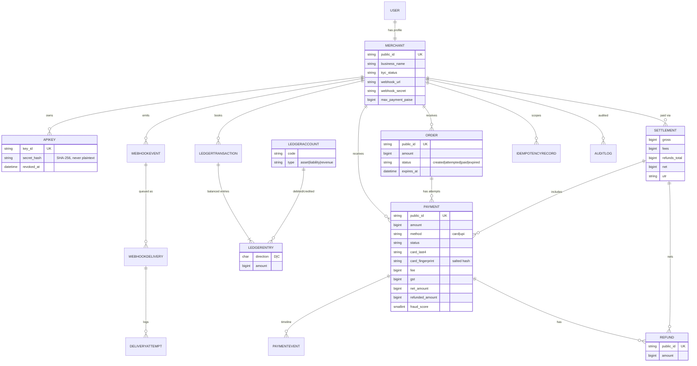

# NovaPay — System Design

## 1. Context

```
 Customer ─────────────▶  Hosted Checkout  ──┐
                          (/pay/<order>/)    │
 Merchant server ──REST (Basic auth)────────▶│   NovaPay (Django, modular monolith)
 Merchant dashboard (session auth) ─────────▶│    ├─ API layer (DRF)           payments/api.py
                                             │    ├─ Service layer             payments/services.py
 Merchant server ◀──signed webhooks──────────┤    ├─ Fraud engine              payments/fraud.py
                                             │    ├─ Ledger                    ledger/services.py
                                             │    ├─ Webhook engine + worker   webhooks/
                                             │    └─ Bank/UPI simulator        payments/simulator.py
                                             ▼
                                         SQLite / PostgreSQL
```

**Why a modular monolith:** one deployable unit with strict layering (views → services → models). All money logic lives in the
service layer so it is testable and reusable by the API, checkout and dashboard alike.

## 2. Layers and responsibilities

| Layer | Files | Rule |
|---|---|---|
| Presentation | `checkout/`, `dashboard/`, `payments/api.py` | No business rules; validate input, call services, format output |
| Service | `payments/services.py`, `ledger/services.py`, `webhooks/services.py` | All state changes, atomic, emit events |
| Domain/data | `*/models.py` | Constraints (CHECK, UNIQUE, FK PROTECT) as the last line of defence |
| Cross-cutting | `core/` | Auth, idempotency, throttling, exceptions, audit |

## 3. ER diagram



Integrity constraints (database level): `amount > 0` on orders/payments/refunds/ledger entries;
`refunded_amount <= amount`; `UNIQUE(merchant, idempotency key)`; `UNIQUE(account code, merchant)`; FK `PROTECT` on financial rows
(a payment can never be deleted out from under the ledger).

## 4. Payment sequence

```
Customer      Checkout/API        Service layer         Fraud   Bank-sim    Ledger     Webhooks
   │  submit card   │                   │                  │        │          │           │
   │───────────────▶│  validate (Luhn,  │                  │        │          │           │
   │                │  expiry, cvv)     │                  │        │          │           │
   │                │──start_payment───▶│──evaluate───────▶│        │          │           │
   │                │                   │◀──score/decision─│        │          │           │
   │                │                   │ create Payment(pending) + fee/GST    │           │
   │                │                   │──charge──────────────────▶│          │           │
   │                │                   │◀─success / otp_required / failed ────│           │
   │                │                   │ CAS: pending→captured                │           │
   │                │                   │ CAS: order created|attempted→paid    │           │
   │                │                   │──post_capture────────────────────────▶ balanced  │
   │                │                   │──emit payment.captured, order.paid──────────────▶│ queued
   │◀──JSON result──│◀──────────────────│                                                   │
   │ redirect (HMAC-signed) → merchant verifies signature, then GET /v1/payments/{id}        │
   │                                                                      worker ──POST──▶ merchant
```

## 5. Concurrency & correctness

| Risk | Mitigation |
|---|---|
| Double charge on retry | `Idempotency-Key` → stored response replayed |
| Two payments racing for one order | Order flips `created/attempted → paid` with one conditional `UPDATE`; the loser is marked failed (`ORDER_ALREADY_PAID`) |
| Parallel refunds exceed payment | One atomic `UPDATE … WHERE refunded_amount <= amount − x` (status computed in the same statement) |
| Parallel settlements | Rows locked (`select_for_update`) and settlement-linked inside one transaction |
| Partial writes | `transaction.atomic()` around payment+ledger+events; SQLite uses `BEGIN IMMEDIATE` |
| Unbalanced books | `_post()` refuses unequal debits/credits; `check_ledger` verifies globally |
| Webhook sent twice by two workers | Delivery row is "claimed" with a conditional update before sending |

These are verified by `tests/test_concurrency.py` (real threads + barrier). Breaking the refund guard makes the test fail.

## 6. Ledger

Accounts: `BANK` (asset), `MERCHANT_PAYABLE` (liability, per merchant), `FEE_REVENUE` (revenue), `GST_PAYABLE` (liability).

| Event | Debit | Credit |
|---|---|---|
| Capture ₹1000 (fee 20 + GST 3.60) | BANK 1000 | MERCHANT_PAYABLE 976.40, FEE_REVENUE 20, GST_PAYABLE 3.60 |
| Refund ₹100 | MERCHANT_PAYABLE 100 | BANK 100 |
| Settlement of net N | MERCHANT_PAYABLE N | BANK N |

Invariant: merchant payable balance == sum(net of unsettled captures) − unsettled refunds.

## 7. Webhooks

`X-NovaPay-Signature: t=<unix>,v1=HMAC_SHA256(secret, "<t>.<raw body>")`; receiver rejects if signature differs or |now−t| > 5 min.
Delivery states: `pending → delivered`, or `retrying` (backoff 10s, 1m, 5m, 30m, 2h) → `failed` after the 6th failure. Every attempt is logged.

## 8. Fraud engine

| Rule | Points |
|---|---|
| Card on blocklist / amount > merchant limit | 100 (block) |
| Amount ≥ ₹50,000 | +20 |
| ≥ 5 attempts from one IP in 10 min | +45 |
| ≥ 3 failures on one card in 1 h | +50 |
| Same card at ≥ 3 merchants in 1 h | +35 |

Score ≥ 80 → **block**, 40–79 → **review** (processed, flagged), else **allow**. Reasons are stored with the payment.

## 9. Security

API secrets hashed (SHA-256) and compared in constant time; secret shown once · card PAN/CVV never stored or logged ·
CSRF on checkout & dashboard · tenant isolation on every query (`merchant=`) · HMAC-signed redirects & webhooks with replay window ·
input validation (Luhn, expiry, VPA, amounts as integers) · rate limiting · audit log with IP · uniform error format that leaks no internals.

## 10. Scaling path
SQLite → PostgreSQL (row locks work as-is) · LocMem cache → Redis · in-process webhook thread → dedicated worker / Celery ·
split the bank simulator into its own service · add read replicas for dashboard analytics.
